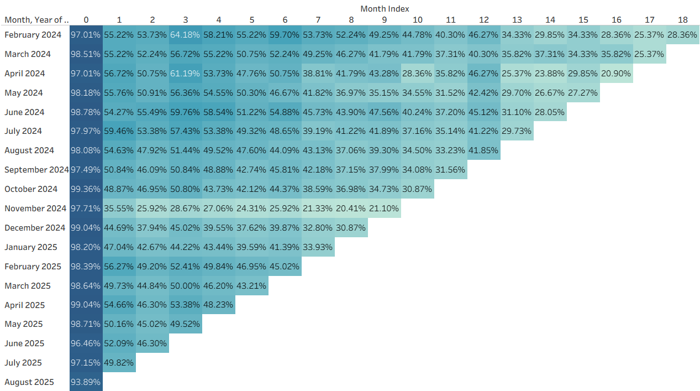
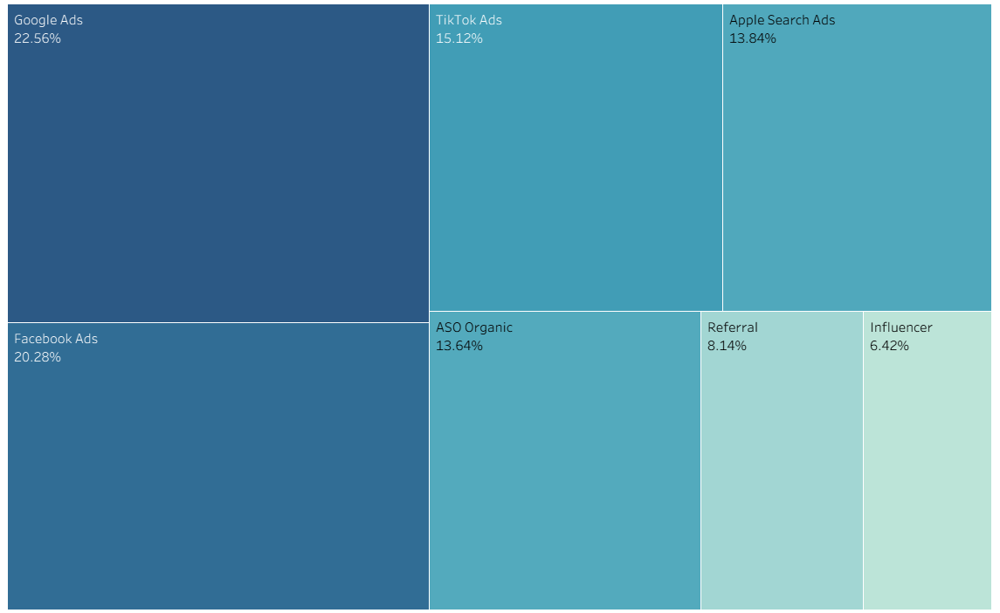

# Аналіз підписочної воронки та юніт-економіки застосунку для вивчення англійської мови

> Аналіз воронки, утримання користувачів та юніт-економіки підписочного застосунку: де втрачаємо користувачів після Trial і які канали залучення та ринки варто фінансувати.

**Інструменти:** SQL, Google Sheets / Excel, Tableau
📊 [Tableau Dashboard](https://public.tableau.com/views/project_17824699690760/Analysisofapp) | 📄 [Повний звіт (PDF)](reports/report.pdf)

---

## Завдання

- З'ясувати можливі причини, через які користувачі не переходять на платну версію після Trial.
- Визначити, які канали залучення є прибутковими, а які марно витрачають бюджет.

## Дані

| Таблиця | Записів | Опис |
|---|---|---|
| `users` | 5 000 | Інформація про користувачів |
| `transactions` | 23 020 | Транзакції користувачів |
| `subscription_plans` | 5 | Довідник тарифних планів |

Додатково створено таблицю `distribution` (555 унікальних комбінацій) з розподілом користувачів за країною, платформою, каналом залучення та віком.

**Період даних:** 02.2024 – 08.2025

## Структура даних

**`users`**

| Колонка | Тип | Опис |
|---|---|---|
| user_id | TEXT PK | Унікальний ідентифікатор (формат U000001) |
| signup_date | DATE | Дата реєстрації |
| country | TEXT | Країна (US, UK, DE, BR, MX, PL) |
| platform | TEXT | Платформа (iOS, Android, Web) |
| acquisition_channel | TEXT | Канал залучення (first-touch) |
| age_group | TEXT | Вікова група (18-24, 25-34, 35-44, 45-54, 55+) |

**`transactions`**

| Колонка | Тип | Опис |
|---|---|---|
| transaction_id | TEXT PK | Унікальний ідентифікатор |
| user_id | TEXT FK | Посилання на `users` |
| date | DATETIME | Дата та час транзакції |
| transaction_type | TEXT | Тип транзакції ([перелічіть значення, напр. trial, purchase, renewal]) |
| plan_id | TEXT FK | Посилання на `subscription_plans` |
| amount_usd | DECIMAL | Сума в USD |
| campaign | TEXT | Маркетингова кампанія на момент транзакції |

**`subscription_plans`** (довідник тарифів)

| plan_id | plan_name | duration_days | list_price_usd |
|---|---|---|---|
| P01 | Weekly Trial | 7 | 6.99 |
| P02 | Monthly | 30 | 14.99 |
| P03 | Quarterly | 90 | 29.99 |
| P04 | Annual | 365 | 59.99 |
| P05 | Lifetime | NULL | 149.99 |

## Хід роботи

1. Побудовано підписочну воронку та розраховано конверсії по етапах.
2. Проведено когортний аналіз утримання за місяцями.
3. Проаналізовано розподіл користувачів і конверсій за країнами, платформами та каналами залучення.
4. Розраховано юніт-економіку (LTV, CAC, LTV/CAC) за країнами та каналами.
5. Сформульовано висновки, рекомендації та гіпотези щодо відтоку.

## Ключові результати

- По **воронці** конверсія на етапі апгрейду становить **20%**, це головна точка росту для збільшення LTV.
- **Утримання** показує, що приблизно **50%** користувачів відсіюється вже протягом першого місяця.
- По **конверсії** найкращі результати у **США**, найгірші в **Мексиці**.
- **Юніт-економіка:** найвище співвідношення LTV/CAC у **Мексиці (6:1)** та **Бразилії (7:1)**.
- Google Ads найбільш ефективний канал залучення, після нього повертаються 75% користувучів. Він найдорожчий (39$), водночас користувачі з даного каналу мають найбільш LTV (109$). Найменш ефективний - Influencer - LTV(80$), Renewal Rate (61.9%), але його відкидати не варто. 

## Рекомендації

- Перерозподілити маркетинговий бюджет на користь каналів у Мексиці та Бразилії, де співвідношення LTV/CAC найвище.
- Не скорочувати фінансування ефективних каналів.
- Протестувати знижки на етапі апгрейду для підвищення конверсії.

## Можливі причини відтоку (гіпотези)

- відсутність локальних способів оплати;
- занадто висока ціна тарифу;
- невідповідність очікуванням від застосунку.

> наявні дані не дозволяють підтвердити їх напряму.

## Візуалізації

**Когортний аналіз утримання за місяцями**



Графік показує, що приблизно половина користувачів відсіюється після першого місяця користування.

**Розподіл за каналами залучення**



Графік, показує, що найбільш прибуткові канали це Google та Facebook Ads.

## Обмеження та подальші кроки

- Перевірити коректність і відтворюваність усіх SQL-запитів (звірити підсумки з вихідними таблицями).
- Перевірити статистичну значущість відмінностей між країнами та каналами.
- Провести A/B-тест знижок на етапі апгрейду, щоб підтвердити або спростувати гіпотезу.
- Створити більш адаптивний дашборд у Tableau.

## Структура репозиторію

```
subscription-funnel-analysis/
├── README.md
├── sql/        # SQL-запити
├── excel/      # Excel / Google Sheets файли
├── report/     # повний звіт (PDF)
└── images/     # скріншоти для README
```

## Автор

**Kateryna Pavlenko**
[LinkedIn](https://www.linkedin.com/in/kateryna-pavlenko-54386a2a7/) | [GitHub](https://github.com/Pavlenko-Kateryna)
